# SongWorkbench

Take a song apart so you can learn it.

## Overview

SongWorkbench is a Mac app for musicians who learn songs from recordings. Import an audio file, and SongWorkbench separates it into instrument stems, finds the tempo, bars, and chords, transcribes and times the lyrics, and builds a chord chart you can play along with. You can slow the recording down, change its key, loop a passage, mute or solo individual instruments, and correct anything the analysis got wrong.

All analysis runs on your Mac. The only network activity is downloading the analysis models when you install them.

**Requirements**

- A Mac running macOS 14 or later. Analysis is designed for Apple silicon.
- About 5 GB of free disk space for the four required analysis models (the two optional refinement models add about 370 MB), plus space for the stems of each song you analyze. You can keep models and stems on an external drive (see [Models and storage](#models-and-storage)).
- An internet connection the first time, to download the analysis models. No account is needed.
- Audio files in MP3, M4A, WAV, AIFF, or FLAC format. Tracks from your Music library work if they are DRM-free and downloaded to your Mac.

## Use cases

- **Learn a song by ear.** Slow the recording to 70% speed without changing its pitch, loop the hard passage, and read the chords from the chart while it plays.
- **Practice along with a band that is missing you.** Mute the guitar (or bass, or vocals) stem and play your part over the rest of the mix.
- **Change the key for a singer.** Shift the pitch up to 12 semitones in either direction, and transpose the chord chart to match.
- **Make a chord chart.** Analyze a recording, correct the chords and lyrics, and export a ChordPro file for your songbook app.
- **Check a chart you already have.** Upload a ChordPro chart you found or wrote, and compare it chord by chord against what the recording plays.
- **Study a song's form.** See the sections, phrase pattern, chord pattern, and rhyme scheme of each verse and chorus.
- **Hear a part on its own.** Play a separated stem as a MIDI instrument to hear the notes clearly.
- **Sketch chords from a live source.** Detect chords from a microphone or a loopback audio device as the music plays.

## Getting started

### Install the analysis models

The first time you open SongWorkbench, a welcome sheet lists the four analysis models it needs: one for stem separation and three for lyric transcription, about 4.9 GB in total. Nothing else in the app works until they are installed.

1. Click **Install All**, or click **Install** next to each model. The sheet shows the total download size.
2. Wait for the downloads to finish. Each model shows a progress bar and a **Cancel** button while it downloads.
3. The sheet closes on its own when the last model is installed.

The models download from their public hosts (Hugging Face and GitHub). SongWorkbench checks each file's size and checksum before it uses it.

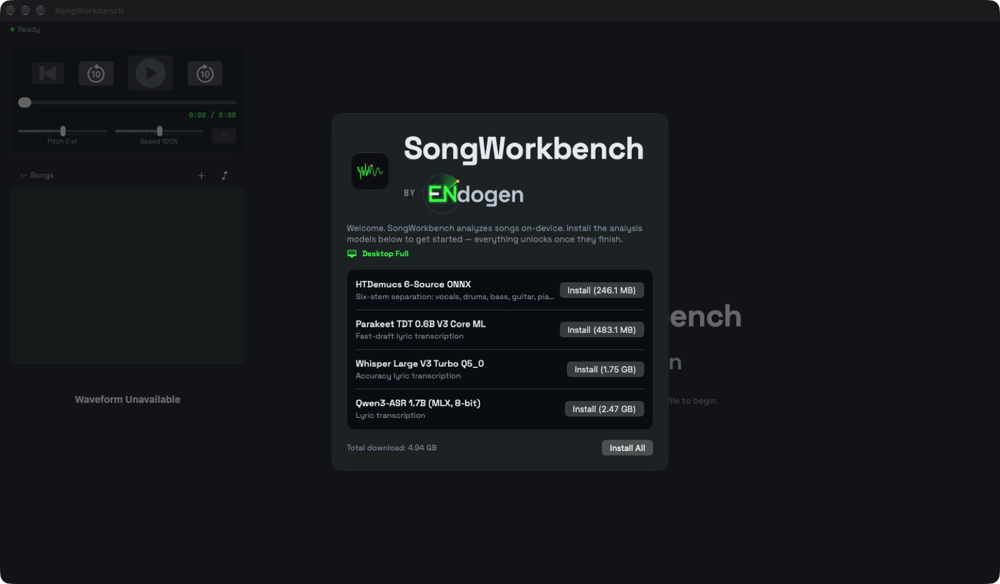
*The welcome sheet lists each analysis model with its purpose and download size.*

### Import a song

Do one of the following:

- Click **+** (Import Songs) above the song list, or choose **File › Import Songs...** (⌘O), and select one or more audio files.
- Drag audio files or folders from Finder onto the song list.
- Click the music note (Open from Music) above the song list, search your Music library by title or artist, and click **Open**.

SongWorkbench copies each file into its own library, so moving or deleting the original later doesn't affect the song. A spinner shows next to a song while it copies.

### Permissions

SongWorkbench asks for these permissions only when you use the feature that needs them:

| Permission | When it is asked | Why |
|---|---|---|
| Media & Apple Music | When you open **Open from Music** | To list the tracks in your Music library and read DRM-free local files. |
| Microphone | When you start Live Capture with **Microphone** or **Loopback** | To listen to the input and detect chords. No audio is saved. |

### Analyze a song

1. Select the song in the song list.
2. Click **Analyze Song**, or choose **Analysis › Analyze Selected Song** (⌘R).
3. A progress sheet shows the current step and its percentage. It closes when analysis finishes. Click **Cancel** to stop.

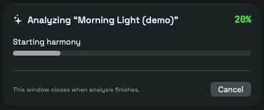
*The analysis progress sheet.*

Analysis runs four stages in order: **Stems** (separation), **Lyrics** (transcription and timing), **Tempo & Chords**, and **ChordPro** (the chart). Results are saved with the song, so you analyze each song once. To analyze every song in the library again, choose **Analysis › Re-analyze All Songs**.

If you edited or imported the song's ChordPro chart, SongWorkbench asks before replacing it. Click **Replace** to make a new draft chart, or **Cancel** to keep yours.

## Features

### Main window

The main window has three columns:

- **Left:** the playback controls, the song list, and the waveform.
- **Middle:** the editor tabs (**Structure**, **Lyrics**, **Chords**, **ChordPro**, **Review**) and the song actions.
- **Right:** the Stem Mix console.

A status row across the top of the window shows what SongWorkbench is doing in the background, such as copying a song, analyzing, or downloading a model. It reads **Ready** when nothing is running.

In the song list, an icon before each title shows its analysis state: dotted for not analyzed, half-filled for partly analyzed, a check mark when stems, lyrics, chords, and the chart are all present, and arrows while it is analyzing or queued. Hover over the icon for details. Drag titles to reorder the list. Type the first letters of a title to jump to it. Click the **Songs** heading to collapse the list to the current song.

When the window is narrower than about 1,380 points, the Stem Mix column collapses to a narrow strip; click it to open the console in a popover.

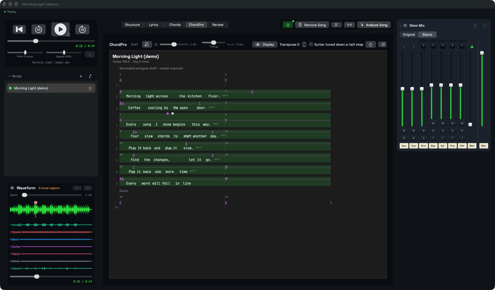
*The main window with the demo song analyzed and the ChordPro tab open.*

### Playback, pitch, and speed

The playback card at the top left controls the selected song.

- Click the play button, or press Space, to play or pause. Space doesn't work while you are typing in a text field.
- Click the rewind button to return to the start, or the 10-second buttons (⌘← and ⌘→) to skip back and forward.
- Drag the progress slider to seek.
- Drag **Pitch** to shift the key from −12 to +12 semitones. Speed doesn't change. After analysis, the label shows the detected key, and the new key when you shift it (for example `E minor→F minor`).
- Drag **Speed** to play from 50% to 150%. Pitch doesn't change.
- Click the reset arrow, or choose **Playback › Original Pitch and Tempo** (⌘0), to return to the original pitch and speed.

The file name of the song shows below the controls.

### Waveform and loops

The **Waveform** panel shows the whole song. After analysis, a colored lane for each stem appears below the main waveform, aligned in time, so you can see where each instrument plays. The panel header counts the vocal regions found.

- Click in the waveform to move the playhead.
- Drag across the waveform to select a loop region.
- Click the repeat button to play the loop; it repeats until you click the stop button. Click the **x** button to clear the loop.
- Drag **Zoom** (1x to 8x) to widen the waveform, then scroll it sideways.

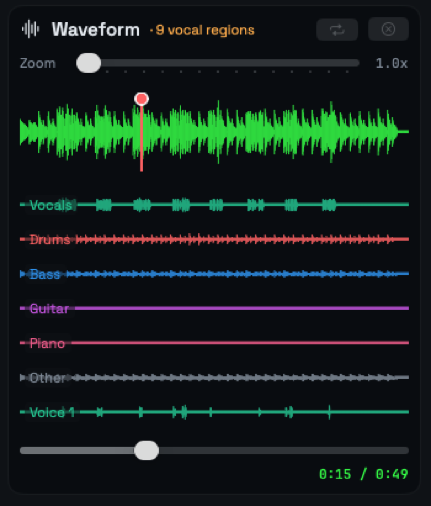
*The waveform with one lane per separated stem.*

### Stem Mix

After the Stems stage, the Stem Mix console on the right has a channel strip for each separated stem: vocals, drums, bass, guitar, piano, and other.

1. Set the **Original / Stems** switch to **Stems** to play the separated mix instead of the original recording. The play button shows a small badge when the stem mix is playing.
2. Drag a strip's fader to set its level. The meter beside it shows the signal.
3. Click **M** to mute a stem or **S** to solo it.
4. Drag the pan control to place a stem left or right.
5. Click the ♪ button on a strip, where there is one, to hear that stem as a MIDI instrument instead of its audio. SongWorkbench transcribes the stem's notes the first time. Click it again to return to the audio. Choose the instrument in **Settings › MIDI Instruments**.

If you separated lead and backing vocals or drum pieces (see [Settings](#settings)), those stems show a disclosure triangle. Click it to show the strips for each part.

The **Met** strip plays a metronome click at the detected tempo, locked to beat 1. Its fader sets the click volume; 0% turns it off. The master strip on the right sets the overall level.

Click the reset arrow to return all faders, mutes, solos, and the master to their defaults. Click the **...** menu to:

- **Load Stem Folder…**: use stems you separated elsewhere. The folder must contain audio files named `vocals`, `drums`, `bass`, and `other`; `guitar` and `piano` are optional. Any supported audio format works.
- **Export Mix…**: save the current mix, with your levels, mutes, and solos, as a WAV file.

Click the **Stem Mix** heading to collapse the console to a narrow strip.

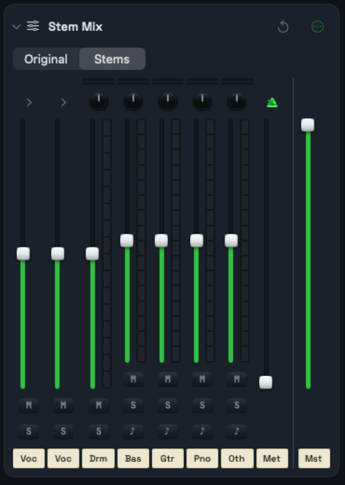
*The Stem Mix console.*

### Structure

The **Structure** tab (⌘1) summarizes the song's form after the Lyrics and Tempo & Chords stages:

- **Form:** each section (verse, chorus, bridge, instrumental) with its start and end time.
- **Templates:** for each kind of sung section, its length in lines, phrase pattern, chord pattern (as Roman numerals relative to the key), lyric meter (syllables per line), and rhyme scheme.
- **Instrumental sections:** how many times they occur, their total time, and their chord pattern.

The **Approximate** label is a reminder that the bridge and solo labels and the phrase pattern are estimates.

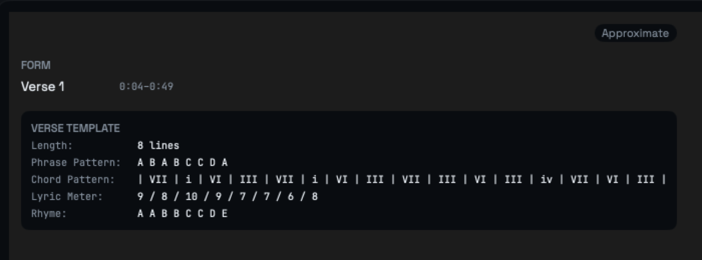
*The Structure tab.*

### Lyrics

The **Lyrics** tab (⌘2) lists each transcribed lyric line with its start and end time. The line that is playing is highlighted, and the list scrolls to follow playback. Section headers such as Intro or Instrumental appear between lines.

- Click a line's text to correct it. Click a time to edit it.
- Click the scissors to split a line at its largest gap between words, or the merge button to join it with the next line.
- Click the trash can to remove a line.
- To add a line by hand, play or scrub to the moment it starts, click **Add Line**, and type the words.
- Click **Paragraphs** to read the lyrics as plain text, and **Timestamps** to return to the list.
- Click the flag to show review flags on lines that look split wrongly.
- Click **Mark Reviewed** when you have checked the lyrics.

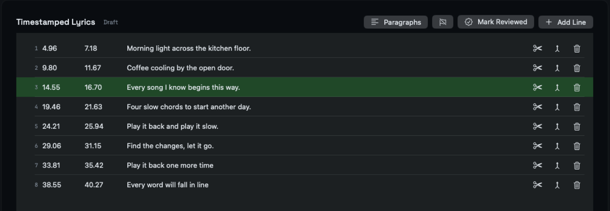
*The Lyrics tab.*

#### Reference lyrics

If you know the real lyrics, you can give them to SongWorkbench so the words and line breaks match exactly.

1. Click the **Reference Lyrics** button (the paragraph icon) in the song actions.
2. Paste the lyrics, one line per line. Or click **Fill from current transcription** to start from the current lines.
3. Click **Align to Audio**. SongWorkbench times your words against the vocals.

The button turns green when reference lyrics are in use. Click **Clear** and align again to return to the raw transcription.

#### Lyric Blend

SongWorkbench transcribes each song with every installed transcription model. The **Lyric Blend** window compares their results line by line.

1. Click the **Lyric Blend** button in the song actions. A green dot means new results are ready.
2. For each line, click the version you want, or type your own correction in **Type a correction...**. A correction always wins and survives re-analysis.

Lines where every model agrees are collapsed; click one to review it.

### Chords

The **Chords** tab (⌘3) shows the chord timeline as a song sheet: each lyric line (or instrumental label) with the chords that sound under it. The header shows the detected tempo in BPM. The chord that is sounding is highlighted during playback.

- Click a chord to see its time and confidence, rename it, change its time, hide it, or remove it. A hidden chord stays in the list but leaves the chart and the click.
- To add a chord, play to its position, click **Add Chord**, and type the name, for example `Ab`.
- Drag **ChordPro confidence** to set the minimum confidence a chord needs to appear on the chart. Click the label to reset it to 50%. The count beside the slider shows how many chords are included.
- Click **Analyze Accompaniment** to run chord detection again on the separated accompaniment.
- Click **Mark Reviewed** when you have checked the chords.

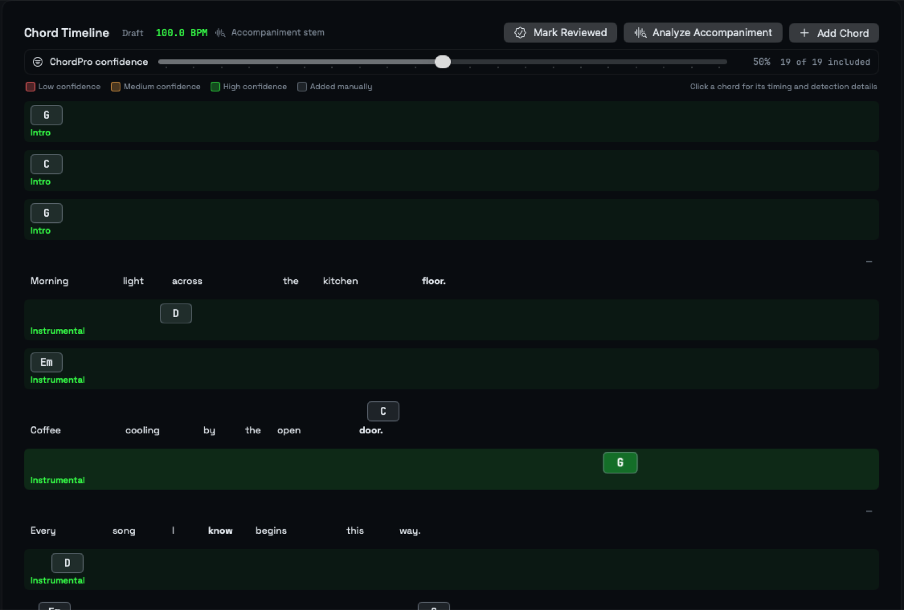
*The Chords tab.*

### ChordPro chart

The **ChordPro** tab (⌘4) shows the song as a chord chart: chords above the lyrics, bar lines, and bar numbers. During playback the current chord and lyric line are highlighted, and bouncing balls follow the words and chords.

- Drag the zoom slider to size the chart. 1.0× fits one phrase to the window width.
- Drag **Timing** to move the highlight and balls earlier or later (−500 to +500 ms) if they look out of step with the audio. This doesn't change the audio. Click **Reset** to return to 0 ms.
- Use **Transpose** to move the chords up or down by up to 12 semitones.
- Select **Guitar tuned down a half step** if your band tunes to E♭: chord names then read a half step up, as the shapes you play.
- Click **Display** to choose what the chart shows (see [Display options](#display-options)).
- Click the export button to save the chart as a ChordPro (`.cho`) file, or the JustChords button to open it in the JustChords app if you have it.
- Click **Upload Reference...** to compare the chart with one you trust (see [Compare with a reference chart](#compare-with-a-reference-chart)).

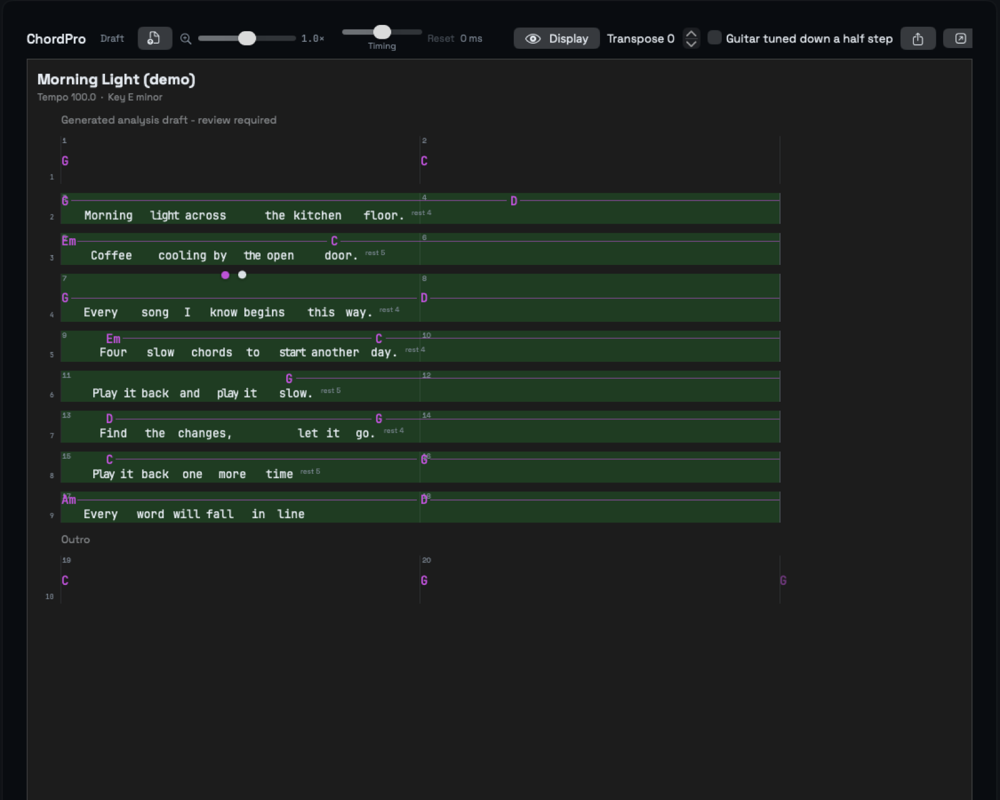
*The ChordPro tab.*

### Review

The **Review** tab (⌘5) shows the same chart with tools for checking and correcting it.

- **Confidence shading:** the background behind each chord shows how confident the analysis is. Click the question mark for the legend.
- **Correct a chord:** click a chord name to rename it, **Accept** it, or **Hide Chord**.
- **Correct a line:** click the circle under a lyric line to accept it, or the pencil to correct its text.
- **Chord placement:** switch between **As saved**, **Beat**, and **Onset** while the song plays to hear where chord changes land best. Switching never edits the chart.
- **Confidence:** drag to set the minimum chord confidence, the same setting as on the Chords tab.
- **Edit:** switch from **App Preview** to **Edit** to change the chart's ChordPro text directly.
- **Import:** click the import button to replace the chart with a ChordPro file.
- **Mark Reviewed:** click the seal when you have checked the chart.

If the lyrics changed after the chart was built, an amber note asks you to regenerate the chart.

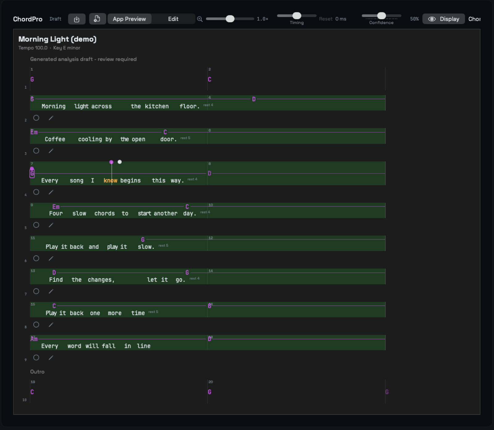
*The Review tab.*

#### Compare with a reference chart

You can check the generated chart against one you trust.

1. Click **Upload Reference...** (the document-with-arrow icon) and choose a ChordPro file for the same song.
2. Use the **Generated / Uploaded** switch to view either chart.
3. Click **Comparison Report** (the checklist icon). The report shows how often the chord roots agree, the chart density, any systemic issues (such as a whole chart off by a key), and each disagreement.
4. To use the uploaded chart as the song's chart, click **Adopt Reference as Chart**. You can rebuild the generated chart later by analyzing again.

#### Display options

Click **Display** to open a panel of check boxes. The Review tab shows every section; the ChordPro tab shows only **Bouncing balls** and **Layout**.

- **Instruments:** for each separated instrument, show its chords, its notes, and (for bass and guitar) its tablature as extra rows. Also **Bass line (detected notes)**, **Vocal harmonies** with 2, 3, or 4 **Harmony voices**, and **Solo tab**. Use the **Compute** buttons to work out each instrument's chords, notes, or solo tab the first time.
- **Grid and waveform:** **Beat dots**, **Waveform** under each line, **Instrument energy** combined or per instrument, and **Chord time labels**.
- **Bouncing balls:** **Word ball** (follows the words), **Chord ball** (travels from chord to chord), and **Chord pop** (pops over each chord change).
- **Layout:** **Guitar tuned down a half step**, **Measure numbers**, and **Beats per row** (Auto, 4, 8, or 16).

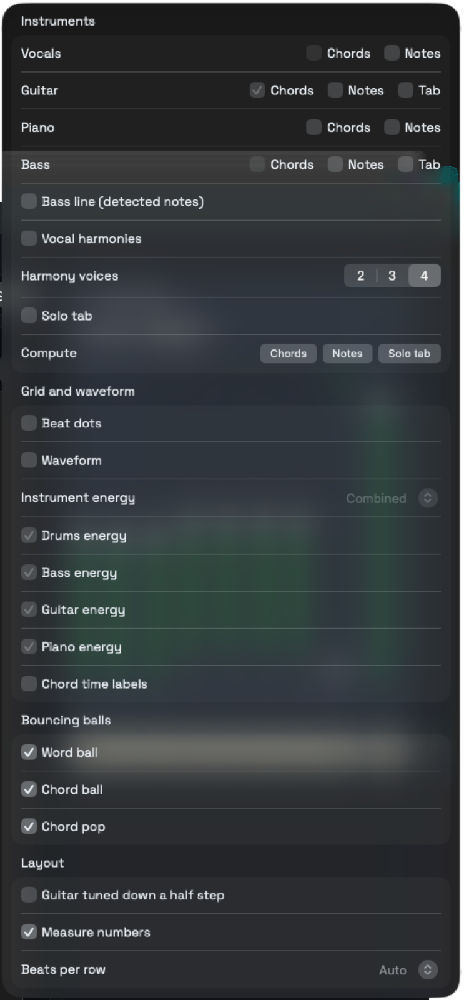
*The Display panel.*

### Live Capture

Live Capture detects chords from audio as it plays and saves them as the selected song's chord timeline.

1. Select a song. The captured chart attaches to it.
2. Click the **Live Capture** button in the song actions.
3. Choose a source. The default is **Loopback**.
    - **Loopback:** an app's audio routed through a virtual audio device such as BlackHole or Loopback. This is the most reliable source.
    - **Microphone:** the room, through your Mac's microphone. Room noise lowers accuracy.
4. Click **Start**. The signal row shows the input level and elapsed time, and detected chords appear as they are found.
5. Click **Stop & Save**. The chords replace the song's chord timeline as a draft. Use the **Timing** slider on the ChordPro tab to correct the small capture delay.

Audio is never saved; only the detected chords are.

The **Another app** source, which would capture another app's output directly, isn't available yet. Choosing it shows an error; use **Loopback** instead.

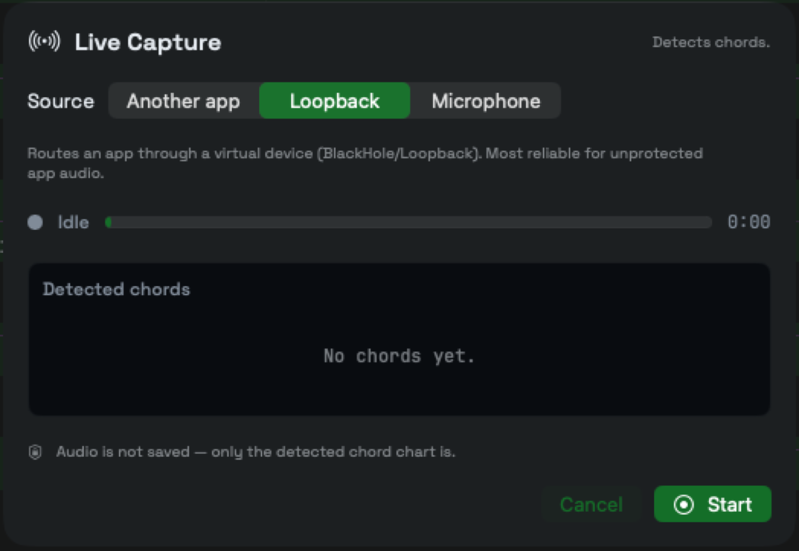
*The Live Capture sheet.*

### Models and storage

Open **SongWorkbench › Settings › Analysis** and click **Models** to see each analysis model and its state. You can **Install**, **Verify**, or **Remove** a model, and cancel a download in progress.

| Model | Purpose |
|---|---|
| HTDemucs 6-Source ONNX | Six-stem separation: vocals, drums, bass, guitar, piano, and other |
| Parakeet TDT 0.6B V3 Core ML | Fast-draft lyric transcription |
| Whisper Large V3 Turbo Q5_0 | Accuracy lyric transcription |
| Qwen3-ASR 1.7B (MLX, 8-bit) | Lyric transcription |
| DrumSep ONNX | Optional: splits drums into kick, snare, cymbals, and toms |
| UVR MDX-Net Karaoke 2 | Optional: splits vocals into lead and backing |

Models and stems can take several gigabytes. To keep them on another drive:

1. Choose **Analysis › Move Models and Stems…**.
2. Choose an empty folder, then click **Move** to confirm. The confirmation shows how much data moves.
3. SongWorkbench copies the files, removes the old copies, and quits. Open it again to continue.

Keep that drive connected whenever you use SongWorkbench. If it isn't connected, SongWorkbench reports the models and stems as missing.

### Text size and other menus

- **View › Bigger Text** (⌘+), **Smaller Text** (⌘−), and **Actual Text Size** (⌥⌘0) scale all text in the app, including the chart.
- **Recent Songs** lists the ten songs you opened most recently.
- To remove a song, click its trash can in the song list, or right-click it and choose **Remove Song**. This removes the song and its analysis from the library.

## Settings

### Settings window

Open **SongWorkbench › Settings** (⌘,). These settings apply to every song.

- **Lead / backing vocals** (Analysis tab): splits the vocals stem into lead and backing during analysis. This is the slowest step and needs the UVR MDX-Net Karaoke 2 model. Default: off.
- **Drum pieces** (Analysis tab): splits the drums stem into kick, snare, toms, and cymbals. Needs the DrumSep model. Default: off.
- **Text size** (Text tab): scales all text in the app, from 85% to 200%. Default: 100%.

The Analysis tab also shows an estimate of how long analysis takes with the options you chose, and the status of each stage for the selected song.

The **MIDI Instruments** tab sets the General MIDI instrument each kind of stem plays when you switch its strip to MIDI. The defaults are:

- Lead and backing vocals: Choir Aahs
- Harmony voices: Voice Oohs
- Bass: Electric Bass (finger)
- Guitar: Acoustic Guitar (steel)
- Piano: Acoustic Grand Piano
- Other: String Ensemble 1
- Drum pieces: Standard kit

### Song settings

These settings are saved with each song.

| Setting | Where | Range | Default |
|---|---|---|---|
| Pitch | Playback card | −12 to +12 semitones | 0 |
| Speed | Playback card | 50% to 150% | 100% |
| ChordPro confidence | Chords and Review tabs | 0% to 100% | 50% |
| Timing | ChordPro and Review tabs | −500 to +500 ms | 0 ms |
| Transpose | ChordPro and Review tabs | −12 to +12 semitones | 0 |
| Guitar tuned down a half step | ChordPro and Review tabs | On or off | Off |

### Chart display settings

These settings apply to every song. Set them with the zoom slider and the **Display** panel on the ChordPro and Review tabs.

| Setting | What it does | Default |
|---|---|---|
| Chart zoom | Sizes the chart from 1/3× to 3×. 1.0× fits one phrase to the window. | 1.0× |
| Word ball, Chord ball, Chord pop | Bouncing balls on the chart during playback. | On (off when Reduce Motion is on) |
| Measure numbers | Bar numbers on the chart. | On |
| Beats per row | How many beats each chart row holds. | Auto |
| Beat dots | A dot for each detected beat (Review tab). | Off |
| Waveform | An audio waveform under each chart line (Review tab). | Off |
| Instrument energy | Energy lanes combined or per instrument (Review tab). | Combined |
| Chord time labels | Time labels before chord-only rows (Review tab). | Off |
| Bass line, Vocal harmonies, Solo tab | Extra rows for detected bass notes, harmony voices, and solo tablature (Review tab). | Off |
| Harmony voices | How many harmony voices to show (Review tab). | 4 |

## Troubleshooting

**The welcome sheet won't close.** It stays open until every required model is installed. If a download fails, click **Install** again. A message such as `Model artifact checksum mismatch` or `Model artifact size mismatch` means the download was damaged; install the model again. Check your internet connection if downloads don't start.

**"No supported audio files were found."** The files you imported or dropped aren't MP3, M4A, WAV, AIFF, or FLAC. Convert them to one of those formats.

**A Music library track can't be opened.** The picker grays out tracks SongWorkbench can't read and says why:

- `Protected by Apple Music DRM`: only DRM-free local files can be analyzed.
- `Not downloaded locally`: download the track in the Music app first.
- `The track's file is no longer on disk`: the file was moved or deleted.

**"Music library access is off."** Turn on SongWorkbench in System Settings › Privacy & Security › Media & Apple Music, then click **Try Again**.

**The stem mix is unavailable.** The console reads `Run Stems separation to enable the mix.` until the song is analyzed. If it reads `Stems are stale — rerun Stems.`, analyze the song again.

**"The accompaniment stem is missing; rerun stem separation before chord analysis."** Analyze the song again so the stems exist before you click **Analyze Accompaniment**.

**"Missing vocals.wav stem." (or another stem) when you load a stem folder.** The folder must contain audio files named `vocals`, `drums`, `bass`, and `other`.

**The chart's highlight runs ahead of or behind the music.** Drag **Timing** on the ChordPro or Review tab until it lines up.

**"Lyrics changed since this chart was built."** You edited the lyrics after the chart was made. Analyze the song again, or retry the ChordPro stage in **Settings › Analysis**, to time the new words.

**A stage failed.** Open **Settings › Analysis**. Under **Stages**, a failed or stale stage shows **Retry**. The main window also shows `Analysis failed:` followed by the reason.

**Live Capture shows "No audio detected from this source."** Protected or streaming audio, such as Apple Music, can't be analyzed. Play a local file in another app through a loopback device, or use the microphone.

**Live Capture says it doesn't have access to the microphone.** Click **Open Microphone Settings**, turn on SongWorkbench, and start again.

**"Capturing another app's audio isn't available yet."** The **Another app** source isn't available in this version. Use **Loopback** or **Microphone**.

**"JustChords wasn't found in Applications."** Install the JustChords app, or click the export button to save a `.cho` file instead.

**Models and stems are missing after a move.** Connect the drive you moved them to, then reopen SongWorkbench.

## Privacy

- SongWorkbench analyzes your audio on your Mac. Audio, lyrics, and charts are never sent anywhere.
- Your library, analysis results, and stems are stored on your Mac (or the folder you chose for models and stems).
- The only network connections are model downloads from their public hosts (Hugging Face and GitHub) when you install a model. No audio or personal data is sent.
- Music library access is read-only and is used only to list and open tracks you choose.
- Live Capture listens only while it runs and saves only the detected chords, never the audio.
- Endogen LLC collects no data from SongWorkbench. See the [Endogen privacy policy](https://endogenllc.com/privacy/).

## Support

Email [support@endogenllc.com](mailto:support@endogenllc.com), or visit the [SongWorkbench page](https://endogenllc.com/songworkbench/).
